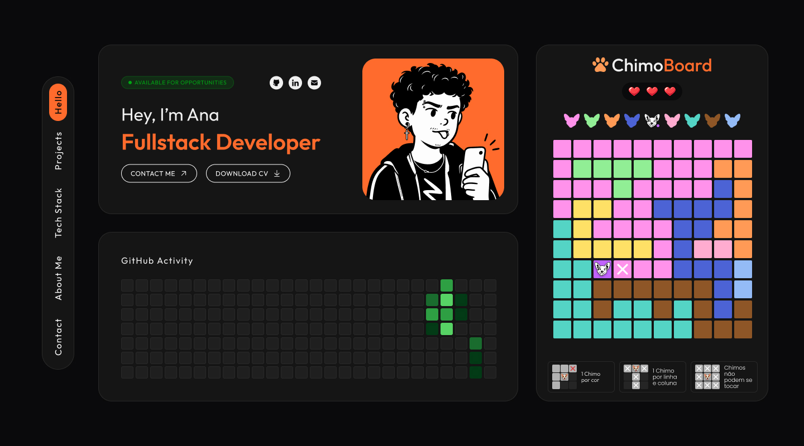

# Ana Siqueira — Portfolio

> A personal portfolio showcasing my work, projects, and skills as a Full Stack Developer.

Built to present my development journey, technical interests, and selected projects through a dark, minimalist interface with custom illustrations and interactive elements.



## ✨ Overview

This portfolio brings together my projects, technical stack, GitHub activity, and a little bit of who I am beyond development.

The interface features a bento-inspired layout, custom visual assets, responsive components, and interactive experiences designed to make exploring my work more engaging.

## 📸 Featured Projects

### Etherea

A personal productivity workspace that integrates Notion features, habit tracking, and customizable widgets into a gamified experience.

### Template Preview

A development tool for processing and rendering HTML email templates, featuring a custom Scriban-based engine, reusable components, mock data, and a dedicated preview API.

### ChimoBoard

A logic puzzle game combining Sudoku and Minesweeper, featuring procedural puzzle generation, unique-solution validation, colored regions, and a limited-lives gameplay system.

### FitAI

A workout management application featuring CRUD operations, a responsive interface, and REST API integration with a Node.js backend and PostgreSQL database.

## 📱 Features

- Responsive layout for desktop and mobile devices
- Interactive GitHub contribution activity
- Embedded ChimoBoard game
- Project showcase with technology tags and repository links
- Custom illustrations and visual assets
- Contact and social media links
- Downloadable resume

## 🚀 Tech Stack


## ⚙️ Getting Started

### Prerequisites

- Node.js
- pnpm

### Installation

Clone the repository:

```bash
git clone https://github.com/itsmesiq/portfolio.git
cd portfolio
```

Install dependencies:

```bash
pnpm install
```

Start the development server:

```bash
pnpm dev
```

Open http://localhost:3000 in your browser.

### Available Scripts

```bash
pnpm dev       # Start development server
pnpm build     # Create production build
pnpm start     # Start production server
pnpm lint      # Run ESLint
pnpm format    # Format code with Prettier
```

## Deployment

The portfolio is deployed on Vercel, with automatic deployment configured through GitHub.

## 👋 Contact

LinkedIn: https://www.linkedin.com/in/itsmesiq/

GitHub: https://github.com/itsmesiq

Email: anasiqueira.serpentis@gmail.com

---

<br>
Built with curiosity, creativity, and code.

© 2026 Ana Siqueira. All rights reserved.
